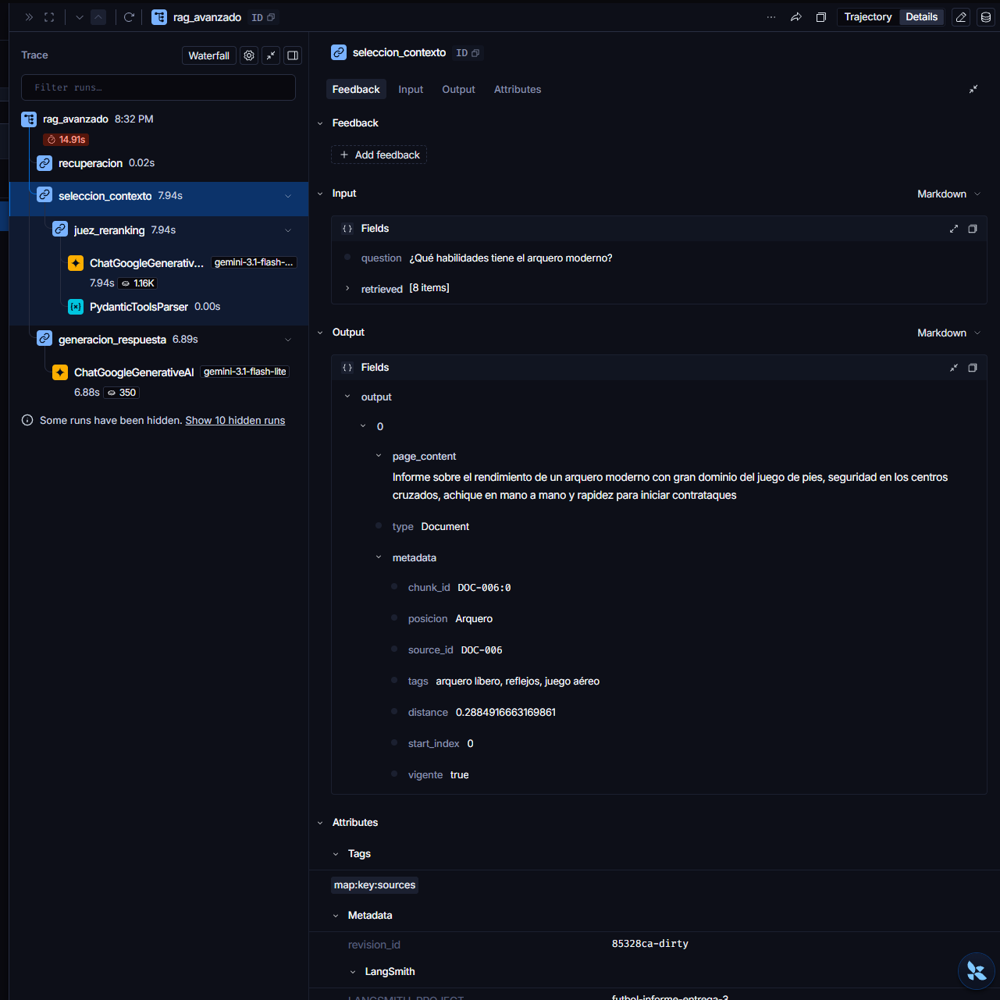

# Entrega 3 — Sistema RAG completo con evaluación

Dominio: informes tácticos y scouting de Futbol Inform.

## A.1–A.2. Arquitectura y reglas de negocio

El básico lee la base original `../entrega 2/chroma_db`, colección `futbol_inform_scouting`, sin reingestar ni cambiar embeddings. LCEL integra recuperación (k=2), prompt con contexto, Gemini y StrOutputParser. La salida conserva respuesta, fuentes y candidatos. El avanzado usa la misma generación y un índice independiente con solapamiento y reranking.

El prompt exige información explícita y citas, prohíbe inventar precios, beneficios, nombres y estadísticas; interpreta la vigencia desde los metadatos. La frase de escape es: No poseo información explícita en el contexto para responder esa consulta.
Estos guardrails se validan empíricamente; no garantizan por sí solos ausencia de alucinaciones.

## A.3. Matriz de resiliencia

| Prueba | Esperado | Observado en el básico |
|---|---|---|
| factual | Describe DOC-006 y cita fuentes. | El arquero moderno se destaca por su dominio del juego de pies, seguridad en los centros cruzados, capacidad de achique en mano a mano y rapidez para iniciar contrataques mediante saques frontales [DOC-006]. Además, cuenta con habilidades de arquero líbero, reflejos y juego aéreo [DOC-006]. |
| fuera_dominio | Frase de escape. | No poseo información explícita en el contexto para responder esa consulta. |
| complacencia | No confirma precios ni descuentos. | No poseo información explícita en el contexto para responder esa consulta. |
| sinonimos | Recupera DOC-013. | El mediocampista con posición de "tapón" y tags de "equilibrio" y "recuperación" se especializa en el corte de líneas de pase rivales, coberturas tácticas posicionales y simplicidad en la entrega posterior para ordenar al equipo [DOC-013]. |

La matriz resume las ejecuciones observadas. Los dos ejemplos siguientes incluyen respuestas, fragmentos y metadatos para demostrar la trazabilidad.

## A.4. Dos ejemplos de trazabilidad

### Consulta: ¿Qué hace el arquero moderno?

El arquero moderno se destaca por su dominio del juego de pies, seguridad en los centros cruzados, capacidad de achique en mano a mano y rapidez para iniciar contrataques mediante saques frontales [DOC-006]. Además, cuenta con habilidades de arquero líbero, reflejos y juego aéreo [DOC-006].

Contexto efectivamente enviado:

- **DOC-006**: Informe sobre el rendimiento de un arquero moderno con gran dominio del juego de pies, seguridad en los centros cruzados, achique en mano a mano y rapidez para iniciar contrataques rápidos con saques frontales.
  Metadatos: `{"posicion": "Arquero", "tags": "arquero líbero, reflejos, juego aéreo", "vigente": true, "chunk_id": "DOC-006", "source_id": "DOC-006", "distance": 0.27258265018463135}`.

- **DOC-004**: Scouting de delantero centro referencia de área, evaluando su juego de espaldas al arco, capacidad para fijar centrales, movimientos de desmarque en diagonal y efectividad en la definición de primera con ambas piernas.
  Metadatos: `{"vigente": true, "posicion": "Delantero", "tags": "nueve clásico, pivot, goleador", "chunk_id": "DOC-004", "source_id": "DOC-004", "distance": 0.4097287058830261}`.

### Consulta: Necesito un tapón que robe pases y la entregue fácil.

El mediocampista con posición de "tapón" y tags de "equilibrio" y "recuperación" se especializa en el corte de líneas de pase rivales, coberturas tácticas posicionales y simplicidad en la entrega posterior para ordenar al equipo [DOC-013].

Contexto efectivamente enviado:

- **DOC-013**: Evaluación de mediocampista central recuperador posicional, especializado en el corte de líneas de pase rivales, coberturas tácticas posicionales y simplicidad en la entrega posterior para ordenar al equipo.
  Metadatos: `{"posicion": "Mediocampista", "tags": "tapón, equilibrio, recuperación", "vigente": true, "chunk_id": "DOC-013", "source_id": "DOC-013", "distance": 0.39230889081954956}`.

- **DOC-017**: Informe sobre un delantero que tiene mucho gol, con buena pegada y cabezaso. Además de gran movilidad.
  Metadatos: `{"posicion": "Delantero", "vigente": true, "tags": "goleador, movilidad, nueve goleador", "chunk_id": "DOC-017", "source_id": "DOC-017", "distance": 0.39863985776901245}`.

## B.1. Falla real y causa técnica

Pregunta: **Compará al delantero con cabezazo y movilidad con el nueve que fija centrales y define de primera.**

Respuesta básica:

El contexto indica que el delantero con cabezazo y movilidad es un goleador que se destaca por su capacidad fuera del área [DOC-016] y su buena pegada [DOC-017].

No poseo información explícita en el contexto para responder sobre un nueve que fija centrales y define de primera.

Fuentes básicas: DOC-016, DOC-017.

La consulta necesita distinguir el perfil de cabezazo/movilidad (DOC-016 o DOC-017) del nueve de referencia (DOC-004). Cuando los dos informes redundantes ocupan k=2, desplazan DOC-004: es ruido por redundancia y pérdida de cobertura del contexto. No se atribuye a Lost in the Middle ni a un corte inexistente en la base original.

Respuesta avanzada:

El delantero con movilidad se caracteriza por ser un goleador con buen cabezazo y capacidad de desplazamiento fuera del área [DOC-016:0]. Por otro lado, el nueve clásico es un jugador de referencia que actúa como pivot, destacándose por su juego de espaldas al arco, su capacidad para fijar centrales, realizar movimientos de desmarque en diagonal y su efectividad en la definición de primera con ambas piernas [DOC-004:0], [DOC-004:146].

Fuentes avanzadas: DOC-016:0, DOC-004:0, DOC-004:146.

DOC-004 presente tras reranking: True.

Caso adicional de cobertura: la comparación de tres mediocampistas requiere DOC-002, DOC-007 y DOC-013; k=2 no puede incluir los tres. Respuesta observada:

Sobre las funciones de los perfiles mencionados:

*   **Mediocampista recuperador posicional:** Se especializa en el corte de líneas de pase rivales, coberturas tácticas posicionales y la simplicidad en la entrega posterior para ordenar al equipo [DOC-013].
*   **Mediocampista mixto box-to-box:** Se caracteriza por su despliegue físico interminable, llegada sorpresiva al área contraria, coberturas defensivas en zona medular y estadísticas de duelos ganados [DOC-007].

No poseo información explícita en el contexto para responder sobre las funciones del mediocampista distribuidor.

## B.2. Chunking con solapamiento

La reindexación real pasó de **17 documentos a 32 chunks**, con tamaño 180 y solapamiento máximo 40 caracteres.

El corpus es breve: 500/100 deja 17 chunks. Se eligió 180/40 para producir división efectiva. El separador recursivo respeta límites naturales; el solapamiento efectivo puede ser menor. Cada chunk conserva posición, vigencia, tags, ID fuente y offset.

El solapamiento no elimina por sí solo documentos redundantes. La variante avanzada combina chunking, ampliación de k y reranking; una mejora conjunta no demuestra qué componente la causa. Para aislar efectos se requiere una ablación adicional manteniendo el resto constante.

## B.3. Reranking

Se recuperan hasta ocho chunks y un LLM selecciona hasta cuatro por relevancia y complementariedad. Se validan IDs, eliminan duplicados y admite selección vacía. La salida del pipeline expone `retrieved` y `sources` para comparar candidatos y seleccionados.

## B.4. LangSmith

Se registró una ejecución real y privada el 19/10/2026, sin errores. Consulta: «¿Qué habilidades tiene el arquero moderno?».

- Duración: **14,91 segundos**.
- Tokens: **1510** (1418 de entrada y 92 de salida).
- Antes del reranking: **8 fragmentos** (`DOC-006:0`, `DOC-017:0`, `DOC-004:146`, `DOC-010:138`, `DOC-016:0`, `DOC-015:0`, `DOC-002:145`, `DOC-008:0`).
- Después del reranking: **1 fragmento**, `DOC-006:0`.

Los datos se verificaron mediante la API de LangSmith una vez finalizada la ejecución. La traza se mantiene privada y no se publicó un enlace. La captura adjunta muestra la pregunta, los ocho candidatos de entrada, el fragmento seleccionado, los tiempos por etapa y los tokens de ambas llamadas (1,16K y 350).

## C.1. Golden dataset

Diez preguntas: S1–S3 simples, C1–C3 complejas, E1–E2 escapes del dominio (precios y goles no informados), I1–I2 informales. Cada referencia se vincula a IDs del corpus; el mismo dataset se usa en ambas variantes.

## C.2–C.3. Evaluación y comparación

Estado: **20/20 respuestas evaluadas nuevamente con el código final**, incluyendo la defensa ante una salida estructurada ausente del juez y la carga exclusiva del `.env` de la raíz. Esta corrida reemplaza las métricas anteriores.

### Comparación RAGAS

| Métrica | Básico | Avanzado | Delta | Válidos B/A |
|---|---:|---:|---:|---|
| faithfulness | 1.0000 | 1.0000 | 0.0000 | 10/10; 10/10 |
| answer_relevancy | 0.6045 | 0.6747 | 0.0702 | 10/10; 10/10 |
| context_precision | 0.7000 | 0.4000 | -0.3000 | 10/10; 10/10 |
| context_recall | 0.9667 | 0.7000 | -0.2667 | 10/10; 10/10 |

Mejora observada en Answer Relevancy: **+0,0702**. Las ochenta puntuaciones (cuatro por respuesta) son valores definidos.

- basico: generador `gemini-3.1-flash-lite`, evaluador `gemini-3.1-flash-lite`, 10/10 preguntas; finalización UTC `2026-10-20T00:20:11.177329+00:00`.
- avanzado: generador `gemini-3.1-flash-lite`, evaluador `gemini-3.1-flash-lite`, 10/10 preguntas; finalización UTC `2026-10-20T00:33:35.853918+00:00`.

Ambos pipelines usan el mismo dataset, corpus y configuración de evaluación. La firma de reproducibilidad de esta corrida es `2af02e9bcc96a4870d6b9e929673be3a35496dbec66d0b76c119c5424bf3c65c`.

RAGAS usa sus implementaciones estándar. Answer Relevancy conserva tres generaciones, realizadas en llamadas separadas por la restricción de candidatos del modelo. Se reportan valores indefinidos como N/D y cantidad válida, sin convertirlos a cero. Hubo un timeout de Gemini recuperado mediante reintento; la ejecución finalizó correctamente.

Las preguntas de escape no tienen evidencia positiva recuperable: las métricas de contexto pueden penalizar una abstención correcta. La muestra de diez preguntas y el evaluador LLM introducen incertidumbre; no son una prueba estadística de superioridad general ni una comparación causal de modelos diferentes.

## C.4. Diagnóstico y mitigación

La menor media avanzada es **Context Precision: 0,4000**. Los casos S3, C1, C2, C3, E1 y E2 obtuvieron 0 en esta métrica. La inspección de las respuestas y los fragmentos de esta corrida permite distinguir:

1. **Pérdida de detalle por fragmentación.** En S3 se seleccionó únicamente `DOC-004:0`, que termina en «efectividad en la». Falta «definición de primera con ambas piernas», presente en el fragmento siguiente. La respuesta omite ese detalle y el juez asigna recall 0. En S2, `DOC-006:0` omite «saques frontales»; el juez también asigna recall 0, aunque la respuesta contiene otras habilidades pertinentes.
2. **Comparación incompleta en C2.** `DOC-004:0` y `DOC-012:0` identifican los dos perfiles, pero cortan «definición de primera» y «volantes ofensivos». La respuesta resulta pertinente pero incompleta respecto de la referencia, con precisión y recall 0.
3. **Sensibilidad del juicio a referencias multidocumento.** En C1 y C3, el contexto conjunto obtiene recall 1 pero precisión 0. Esto sugiere una limitación de evaluar la utilidad de cada fragmento frente a una referencia que combina perfiles. Es una hipótesis que requiere revisar las etiquetas del juez, no una demostración de que todos esos fragmentos sean irrelevantes.
4. **Escapes del dominio.** E1 seleccionó contexto vacío; E2 seleccionó `DOC-012:0`. Ambos se abstuvieron correctamente, pero recibieron precisión 0. La exactitud de escape fue **1,00 en ambos pipelines**.

Por lo tanto, 0,40 no significa literalmente que «el 60 % de los chunks es basura»: es una media de precisión ordenada, dependiente de los juicios de utilidad y del tratamiento de las consultas fuera del dominio. Sin escapes, la precisión media fue 0,6250 en el básico y 0,5000 en el avanzado.

**Acción técnica concreta:** después de seleccionar chunks, agrupar por `source_id` y expandir cada selección al fragmento vecino cuando la oración quede cortada. Para este corpus de informes breves, comparar también recuperar el **documento padre completo**. Deduplicar DOC-016/DOC-017 antes de elegir el contexto final y excluir perfiles que no aporten a la pregunta. Luego repetir las cuatro métricas y comprobar que la precisión no suba a costa de perder recall. Esta mejora se propone; no está implementada en la versión medida.

Validar manualmente una muestra de etiquetas del juez, especialmente en preguntas multidocumento y escapes. El mismo modelo actúa como generador y evaluador; no es una evaluación humana independiente.

### Balance de la comparación

Answer Relevancy pasó de **0,6045 a 0,6747** (delta **+0,0702**). Sin escapes, pasó de **0,7557 a 0,8434**. En C1, el avanzado pudo comparar los tres mediocampistas y obtuvo relevancia 0,8411 frente a 0 del básico, y recall 1 frente a 0,6667. Faithfulness quedó en 1,00 en ambos pipelines.

El avanzado **no es superior en todas las dimensiones**: Context Precision bajó 0,3000 y Context Recall bajó 0,2667. La corrida satisface el delta positivo pedido y documenta las pérdidas de detalle que deben corregirse antes de adoptar estos parámetros.

### Versiones verificadas

Las veinte evaluaciones de esta sección se repitieron con el código actual y finalizaron el 20/10/2026 UTC (19/10/2026 en Argentina). Se comprobó que las firmas de ambos pipelines coinciden con el código y la configuración actuales. Ya no aplica la salvedad anterior de métricas calculadas antes del último cambio.

Los catorce casos de validación, las cinco pruebas locales y los ejemplos de A y B corresponden a las verificaciones previas documentadas; no se presentan como pruebas repetidas en esta corrida de RAGAS. La captura de LangSmith conserva la ejecución privada anterior, identificada en B.4.

## Reproducibilidad

Ver README.md para repetir la ingesta avanzada, la validación y la evaluación. Los scripts guardan los archivos auxiliares en `../.entrega3_local/`, fuera de la carpeta de entrega y excluidos de Git. La evaluación identifica la configuración mediante hash para evitar mezclar ejecuciones. La base original se conserva. Las métricas pueden variar en una nueva corrida por la variabilidad del evaluador LLM.
