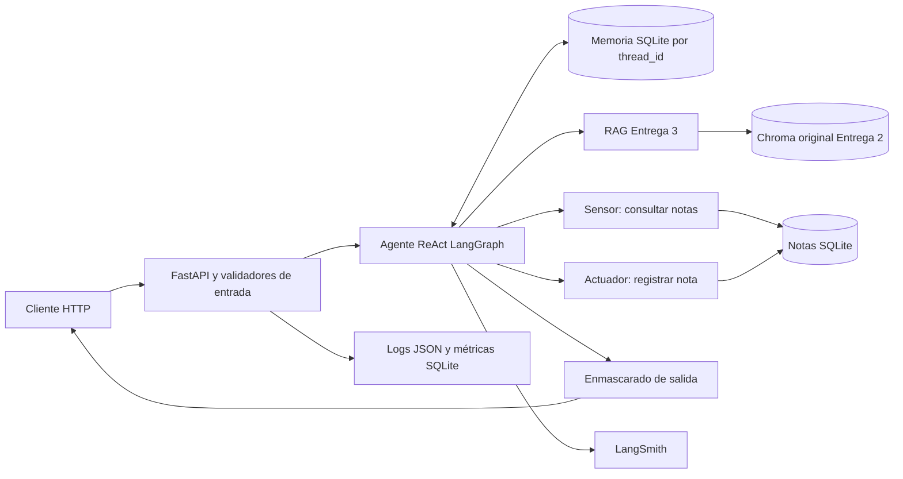

# Ficha técnica — Fútbol Inform

## Identificación y propósito

TP Final Integrador de Desarrollo de Sistemas de Inteligencia Artificial (IADS 3).
Dominio: consulta de informes tácticos de fútbol y registro de notas de scouting.
Repositorio: https://github.com/santicascallar/DSI_Integrador (rama de entrega: `main`).
El sistema ayuda a consultar evidencia; no determina contrataciones ni inventa
estadísticas o identidades ausentes del corpus.

## Arquitectura

## Componentes

| Elemento | Implementación |
|---|---|
| Lenguaje | Python 3.12 |
| Modelo | Gemini, configurable por `GEMINI_MODEL`; valor por defecto `gemini-3.1-flash-lite`, temperatura 0 |
| Embeddings | `gemini-embedding-001` |
| Corpus | 17 documentos en `entrega 2/base_conocimiento.json` |
| Recuperación | RAG básico de E3, dos documentos recuperados, citas `DOC-*` |
| Agente | `create_react_agent`, tres herramientas, presupuesto configurado de cinco iteraciones (`recursion_limit=11`) |
| Memoria | `SqliteSaver`, clave `thread_id` |
| Sensor | `consultar_notas_seguimiento(jugador)`, hasta veinte notas recientes |
| Actuador | `registrar_nota_seguimiento(jugador, nota)`, inserción parametrizada en SQLite y devolución del ID |
| Permiso de escritura | Orden imperativa al comienzo: «Registrá…», «Guardá…», «Anotá…», «Agendá…» o «Dejá asentado…», opcionalmente precedida por «Por favor» |
| Dependencias reproducibles | `entrega_4/requirements-lock.txt` |

## Contrato HTTP

| Método y ruta | Entrada / salida |
|---|---|
| `GET /health` | Estado del servicio y `agent_ready` |
| `POST /consultar` | JSON con `consulta` y `thread_id` opcional; devuelve respuesta, hilo, `trace_id`, tokens y costo estimado |
| `GET /estado/{thread_id}` | Historial de usuario/asistente enmascarado; 404 para hilo inexistente |
| `GET /metricas` | Consultas, errores, bloqueos, latencia media/p95, herramientas, tokens y costos |

`X-API-Key` se requiere en rutas de datos si existe `API_ACCESS_TOKEN`.
La consulta acepta entre 1 y 4000 caracteres después de quitar espacios extremos;
`thread_id` admite hasta 128 caracteres alfanuméricos y `._:-`.

## Persistencia y observabilidad

En `.entrega4_local`: `memory.sqlite3`, `scouting.sqlite3`, `metrics.sqlite3` y
`logs.jsonl`. `ENTREGA4_DATA_DIR` permite aislar una ejecución. Un único proceso
Uvicorn es la configuración demostrada. Los datos permanecen tras reiniciar.

LangSmith recibe el grafo y llamadas anidadas cuando tracing está habilitado.
Las métricas de consultas corresponden a ejecuciones que ingresan al handler y
a rechazos del esquema; no incluyen fallos de autenticación. Los bloqueos incluyen los del actuador.
Los errores cuentan fallos de ejecución y entradas rechazadas por el esquema;
la inyección se cuenta como bloqueo. La latencia p95 usa rango más próximo.

Costo estimado: `(tokens_entrada × tarifa_entrada + tokens_salida × tarifa_salida) / 1_000_000`.
Incluye uso LLM observado por callbacks, no el costo de embeddings ni una factura.
Si una ejecución falla antes de devolver su uso, sus tokens pueden quedar sin contabilizar.

## Seguridad y límites

Dos validadores de entrada (longitud e inyección) y filtro de salida para email,
teléfono, DNI y CUIL, aplicado también al historial. Las reglas de escritura son
conservadoras y pueden rechazar pedidos válidos formulados de otra manera.
Las expresiones regulares no cubren todos los ataques ni todos los datos personales.
El historial interno y las trazas pueden contener texto sin enmascarar; no ingresar
datos sensibles en la demostración. El token es compartido y no separa usuarios.
No hay garantía de exactitud del LLM ni pruebas de carga o alta disponibilidad.

## Validación y operación

Suite local: `python -m pytest entrega_4/tests -q`; seguridad: `python security_tests.py`.
Validación real: `python -m entrega_4.validacion_real`. Instrucciones completas,
reconstrucción de corpus y ejemplos autenticados en [README.md](README.md).
Resultados y límites de la validación en [informe.md](informe.md).
